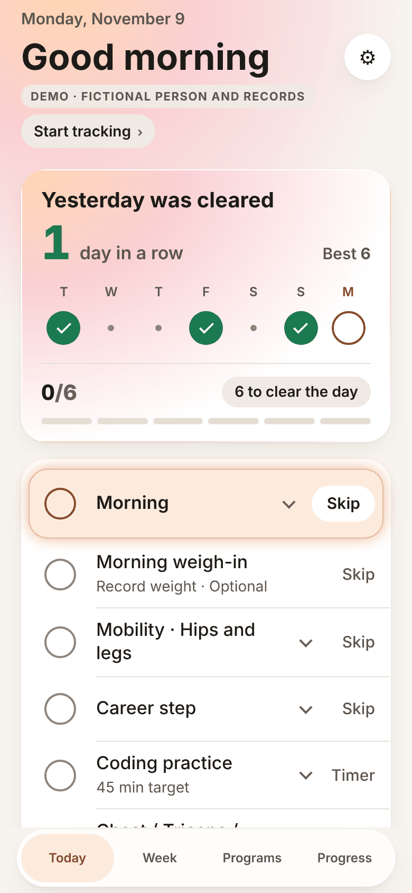
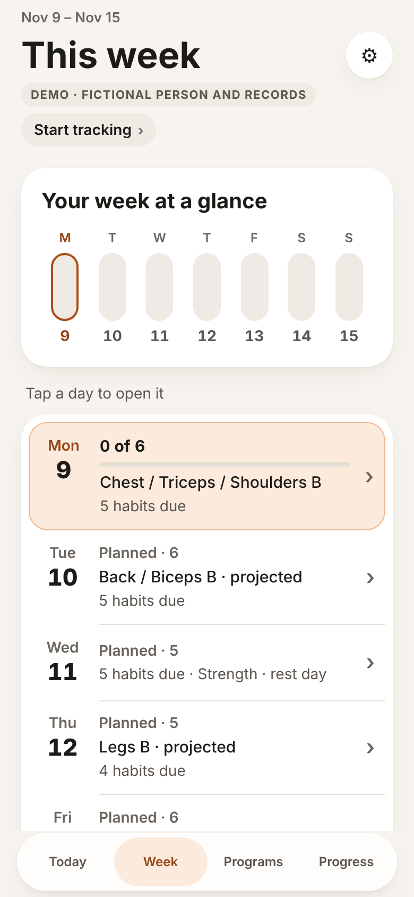
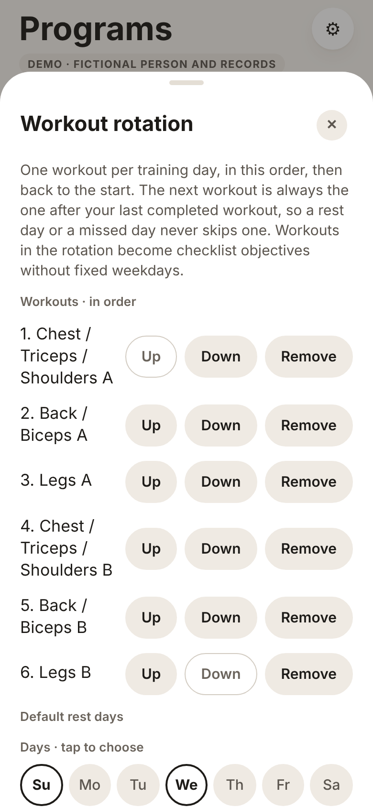
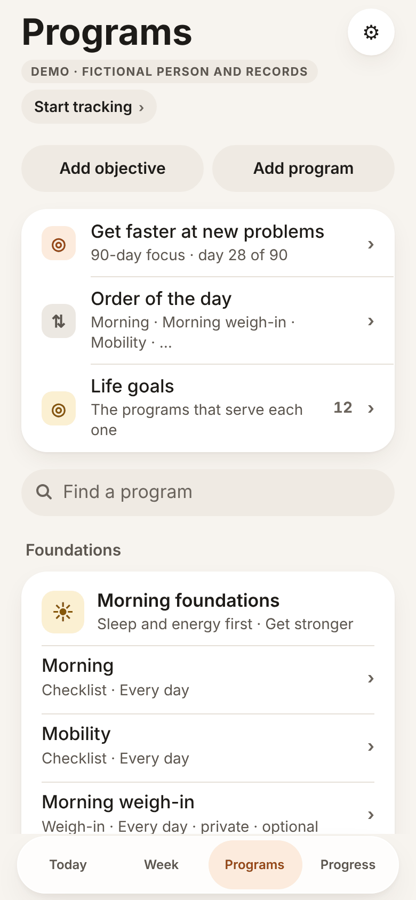
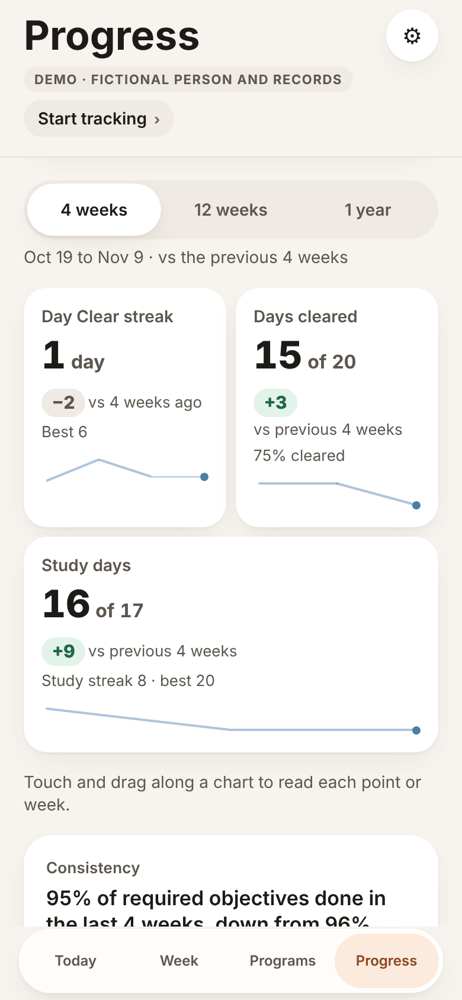
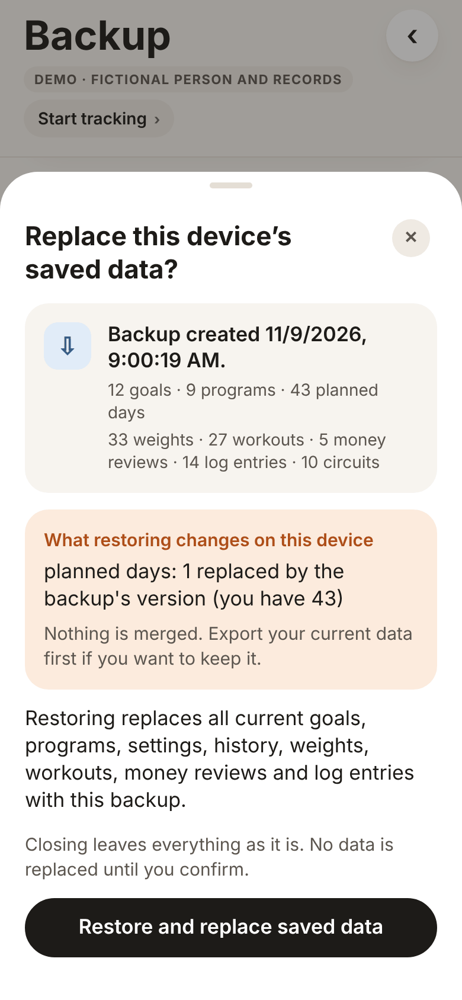
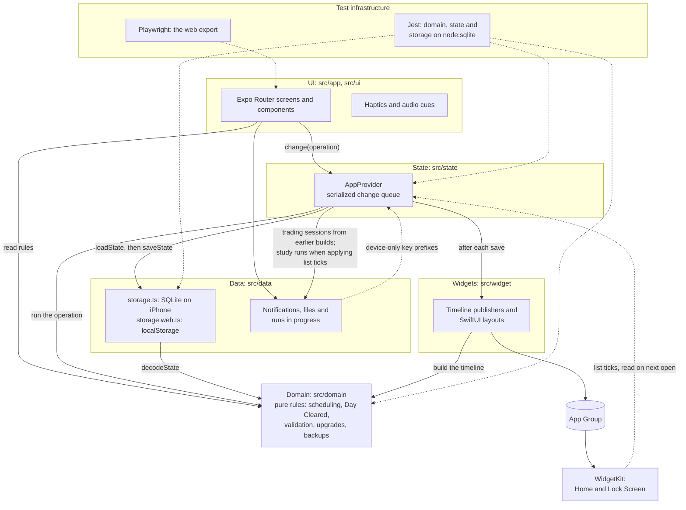

# Life OS

[](https://github.com/garrettm19/life-os/actions/workflows/ci.yml)

Life OS is a local-first iPhone app that turns long-term goals into a short daily checklist and records what actually happened.

Goals are served by programs (a strength rotation, a study plan, a morning routine). Each day, the routines that are due become one list on Today. Done, Skip and Undo record the day, a day is **cleared** when everything required is done, and Progress reads the records back so the plan can be adjusted. It is built for one person planning their own days on their own phone: there is no account and no server. The app sends nothing anywhere, and data leaves the device only in a file the user exports. The only network use is opening a link the user added to a routine, in the browser, when it is tapped.

Most of the engineering is below the screens: a pure TypeScript domain layer, a single writer that saves to SQLite before the UI changes, and data formats that upgrade one version at a time ([engineering highlights](#engineering-highlights)).

## Application preview

<table>
  <tr>
    <td align="center" width="33%"><br><sub><b>Today</b>: one list in the order of the day</sub></td>
    <td align="center" width="33%"><br><sub><b>Week</b>: rotation workouts projected, rest days kept</sub></td>
    <td align="center" width="33%"><br><sub><b>Workout rotation</b>: the next workout derived from the last one done</sub></td>
  </tr>
  <tr>
    <td align="center"><br><sub><b>Programs</b>: goals, programs and routines</sub></td>
    <td align="center"><br><sub><b>Progress</b>: recorded values only</sub></td>
    <td align="center"><br><sub><b>Restore preview</b>: validated and compared before anything is replaced</sub></td>
  </tr>
</table>

<sub>Captured from the browser preview at iPhone width (390 pt, 2x) with the built-in demo, a fictional person's six weeks. How they were taken: [docs/images](docs/images/README.md).</sub>

## Features

- **Today** as one list in the order of the day, with the next thing highlighted and Done, Skip and Undo on every row.
- **Scheduling** by weekday, every N weeks, or as a workout rotation with rest days and companion routines. Generate day places timed sessions around work hours and says why when one does not fit.
- **Day Cleared and streaks** from one rule: Skip excuses an objective for the day, a protected day holds the streak, and a day never opened is neutral.
- **Recorders** where the data is useful: workout sets, an interval timer with audio cues, timed study sessions, body weight and a weekly money review.
- **Progress** charts of recorded values only, each with a plain sentence above it and a list view for VoiceOver, plus a weekly review.
- **Home Screen and Lock Screen widgets**, including a list that can be ticked on iOS 17, with nothing private on them.
- **Backups** as versioned JSON with a restore preview, a CSV or JSON analysis export, and a setup-file import.
- **A trading checklist**: one status from a priority table, fixed-dollar position sizing and cooldowns, all self-reported. It never connects to a broker.

Every feature and term is described in [docs/FEATURES.md](docs/FEATURES.md).

## Tech stack

| Technology                                                     | Responsibility                                                                                      |
| -------------------------------------------------------------- | --------------------------------------------------------------------------------------------------- |
| Expo SDK 57, React Native 0.86, React 19.2                     | The app, its native modules and the iOS build, with the React Compiler on                           |
| TypeScript (strict)                                            | All application, test and build code                                                                |
| Expo Router (typed routes)                                     | File-based screens in `src/app`: four tabs, Settings and the trading pages                          |
| React context and a serialized queue                           | App state, with no state library ([ADR 8](docs/decisions/0008-no-state-chart-or-schema-library.md)) |
| `expo-sqlite`                                                  | The on-device database, and a key-value store for runs in progress                                  |
| `expo-widgets`, `@expo/ui`                                     | Home Screen and Lock Screen widgets as SwiftUI written in TypeScript                                |
| `expo-notifications`                                           | Local study reminders only                                                                          |
| `expo-haptics`, `expo-audio`, `expo-speech`, `expo-keep-awake` | Touch feedback, timer cues, and keeping the screen on during a circuit                              |
| `expo-sharing`, `expo-document-picker`, `expo-file-system`     | Backup, export and setup files                                                                      |
| `react-native-reanimated`                                      | Motion                                                                                              |
| React Native Web                                               | The browser preview, which is also the browser-test target                                          |
| Jest (`jest-expo`) with Node's `node:sqlite`                   | Unit tests, and storage tests that run the production SQL                                           |
| Playwright (Chromium)                                          | Browser tests and the layout gate against the web export                                            |
| ESLint, Prettier, GitHub Actions, EAS Build                    | Lint and formatting, CI on every pull request, iPhone builds                                        |

## Architecture



- **UI** (`src/app`, `src/ui`): Expo Router screens, components, hand-drawn charts, haptics and timer cues. Screens build pure operations and read rules; the saved state changes only through `change`.
- **State** (`src/state`): one React context and the only writer. `change` runs one operation at a time on the last saved state, saves the result, then shows it, then publishes the widgets.
- **Domain** (`src/domain`): about 60 modules of deterministic rules with no React, storage or native imports. The current time comes in as an argument, so every rule is tested without rendering.
- **Persistence** (`src/data`): SQLite with one JSON-payload table per record type, migrated by `PRAGMA user_version`. Each platform-specific adapter has a `.web.ts` sibling for the browser.
- **Platform integrations:** widgets read timelines from a shared App Group, study reminders are local notifications, and haptics, audio and the share sheet are used where they help. None of them is a source of truth.
- **Tests** run beside the code (Jest) and against the web export (Playwright), in CI on every pull request.

The modules, the data flow and a guide to [where to start reading](docs/ARCHITECTURE.md#where-to-start-reading) are in [docs/ARCHITECTURE.md](docs/ARCHITECTURE.md). The stored data and its versions are in [docs/DATA_MODEL.md](docs/DATA_MODEL.md), and the reasons behind the main choices in the [decision records](docs/decisions/README.md).

## Engineering highlights

### A single writer that saves before it shows

- **Challenge:** every tap must be stored before the screen acknowledges it, two quick taps must not race, and the history grows by a day at a time.
- **Approach:** [`change`](src/state/app-state.tsx) chains each pure operation onto one promise queue and runs it on the last committed state, not the last render. [`saveState`](src/data/storage.ts) validates the result, compares every row with the last saved copy and writes only the changed rows in one exclusive SQLite transaction. Only then does React receive the new state, and the widgets are published after that without holding it up.
- **Decisions:** one table of JSON payloads per record type; a failed transaction forgets the saved snapshot, so the next save rewrites everything ([ADR 6](docs/decisions/0006-sqlite-and-a-serialized-save-queue.md)).
- **Tradeoffs:** each save still serializes every row to compare it, so its cost grows with history. Payloads are opaque to SQL: the whole state is loaded into memory and read there.

### Data formats that upgrade one step at a time

- **Challenge:** a phone may open data written by any earlier build, or be handed a backup from a newer one, and the state, the SQLite schema and the backup file change at different times.
- **Approach:** three separate version numbers, all 5 today. The schema migrates in one exclusive transaction. [`decodeState`](src/domain/data.ts) validates and upgrades the state one version at a time on every load, save, restore and import, and [`parseBackup`](src/domain/backup.ts) accepts formats 1 to 5. A database and a backup written by a real version-3 build are kept as fixtures and must upgrade unchanged ([test](src/data/__tests__/version-3-build.test.ts)).
- **Decisions:** newer data is refused rather than guessed at, and so is data that claims an older version while carrying a newer version's lists ([ADR 5](docs/decisions/0005-stepwise-versioned-formats.md)). Decoders are hand-written, with no schema library ([ADR 8](docs/decisions/0008-no-state-chart-or-schema-library.md)).
- **Tradeoffs:** upgrades are one-way, and every new field means editing its validator by hand.

### One rule for Day Cleared, derived on every read

- **Challenge:** Today, Week, Progress, the streak, the celebration and a widget all ask whether a day was cleared, and an early version had two answers that disagreed.
- **Approach:** [`dayProgress` and `dayOutcome`](src/domain/objectives.ts) are the only definition. Skipped objectives are excused, optional ones never count, a protected day holds the streak and a past day never opened is neutral. `dayClearRuns` derives the streak from stored days on every read, checked against a walk of every calendar day over two years ([test](src/domain/__tests__/scale.test.ts)).
- **Decisions:** no stored counters, so Undo or an edit to a past day recomputes everything ([ADR 3](docs/decisions/0003-one-rule-for-day-cleared.md)).
- **Tradeoffs:** private objectives count in the total, so the widget's day status has to be an explicit opt-in, and deriving on read means walking the stored days each time.

### Scheduling from rules and history

- **Challenge:** routines repeat on weekdays or every N weeks, workouts rotate with rest days, and timed sessions must fit around work hours, all in local calendar dates that hold across daylight-saving changes and UTC+14, without rewriting a past day.
- **Approach:** one due-day rule, [`onItsDays`](src/domain/repeat.ts), with repeats counted in Monday-to-Sunday weeks from an anchor week. [`nextWorkout`](src/domain/rotation.ts) derives the next workout from the last one completed. [`generateDay`](src/domain/planner.ts) places fixed routines first, then each flexible one in the first free gap of its window (`findSlot`), and every plan change keeps the previous plan as a revision. CI runs the unit suite in UTC, `Pacific/Kiritimati` and `America/New_York`.
- **Decisions:** reconciliation touches today and later only, and Week computes later days on a copy that is never saved ([ADR 4](docs/decisions/0004-history-is-never-rewritten.md)).
- **Tradeoffs:** placement is greedy first-fit with no backtracking; a session that does not fit is reported with a reason rather than moved elsewhere.

## Getting started

### Requirements

- Node 24.19 or a later 24.x (`.nvmrc` pins 24.19.0) and npm, using the committed lockfile.
- For the browser tests: Playwright's Chromium (`npx playwright install chromium`).
- For an iPhone: an Apple Developer account, and either an Expo account for EAS Build or a Mac with Xcode.

### Browser preview

```sh
npm ci
npm run web
```

Open the URL Expo prints, then tap **Explore demo** on the empty Today. It loads six weeks of a fictional person's records, labeled DEMO on every screen. **Start tracking** keeps the demo's programs without its history, and Settings → Reset this device's plan returns to the empty app. [docs/DEMO_GUIDE.md](docs/DEMO_GUIDE.md) is a five-minute walk through it.

The preview runs every screen and rule, including the demo, scheduling, Day Cleared, backups (as a download) and restore (from a chosen file). It keeps its data in the browser's `localStorage`.

### On an iPhone

| Way to run         | Status                                                                                                                                                                                 |
| ------------------ | -------------------------------------------------------------------------------------------------------------------------------------------------------------------------------------- |
| Expo Go            | Not supported, and not tested: the widgets, their App Group and the widget extension need a native build of this project. The widget layouts also load `@expo/ui` when the app starts. |
| EAS Build          | How the app is built for the phone: `npx eas-cli build --platform ios --profile preview` makes an internal-distribution build.                                                         |
| `npx expo run:ios` | The standard local build on a Mac with Xcode. It has not been exercised for this project.                                                                                              |

Before a native build under your own account, remove `owner` and `extra.eas.projectId` from `app.json`, change the app's bundle identifier, the widget target's bundle identifier and the App Group to ones your Apple team owns, and run `npx eas-cli init`.

These need a native build and are not in the browser preview: the Home Screen and Lock Screen widgets and their ticks, haptics, local study notifications, the share sheet and document picker, and SQLite storage.

Every script, the checks for each kind of change and the conventions are in [CONTRIBUTING.md](CONTRIBUTING.md).

## Testing

```sh
npm run verify                              # typecheck, lint, unit and SQLite tests, format check
TZ=Pacific/Kiritimati npm run test:ci       # the unit suite at UTC+14
TZ=America/New_York npm run test:ci         # the daylight-saving tests
npm run export:web && npm run test:web      # browser tests and the layout gate
```

- **Unit tests** (about 1,400 in 107 files) sit in `__tests__` folders beside the code. They cover the domain rules, the change queue, backups and the restore preview, reminder planning, and the widget layouts as the extension receives them, checked for private data.
- **Storage tests** run the production SQL on Node's built-in SQLite: migrations from every earlier version, incremental saves, rollback, refusal of malformed rows, and a database and backup from a version-3 build.
- **Browser tests** (about 300 in 45 Playwright files) drive the web export at an iPhone 13 viewport. The layout gate fails a screen at 320, 375, 390 or 430 pt wide on sideways scrolling, clipped or overlapping text, or a touch target under 44 pt.
- **CI** ([`ci.yml`](.github/workflows/ci.yml)) runs all of these, the dependency checks, Expo Doctor and both exports on every pull request and push to `main`.

Browser tests prove behavior in React Native Web, not on an iPhone. Fonts, Dynamic Type, VoiceOver, safe areas, haptics, native SQLite, notifications and widgets are checked by hand with the device checklist in [docs/TESTING.md](docs/TESTING.md), which also maps each central behavior to its tests.

## Project status

**Works:** every feature listed above is implemented and has unit tests, and browser tests cover everything the web build can run; widgets, notifications and haptics are checked by hand on a device. The data formats are at version 5, with upgrade paths from every earlier version. There is no App Store release; builds are installed through EAS internal distribution.

**Known limitations**, in full in [docs/KNOWN_LIMITATIONS.md](docs/KNOWN_LIMITATIONS.md):

- iPhone behavior is verified by hand only; no native test runner or simulator runs in CI.
- One device only: no sync, and backups are unencrypted files the user keeps.
- If saved data cannot be read, nothing is overwritten, but the app offers only Retry.
- iOS decides when widgets refresh.
- Some screens and domain modules are large, at 1,200 to 1,800 lines.

**Possible next steps**, none of them started: a recovery path from unreadable data through a backup file, splitting the largest screens and modules by concern, a retention design before history nears the 20 MB backup cap, and parallel CI jobs.

## License

[MIT](LICENSE). The app icon and the timer tones were made for this project and are covered by the same license. Third-party packages keep their own licenses.

Life OS is a personal productivity tool. Nothing in it is financial, trading, investment, medical or psychological advice, and the trading checklist cannot stop an order. "Life OS" is a working name, not affiliated with any other product or company of a similar name.
