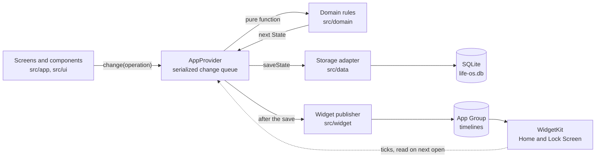

# Architecture

Life OS is an Expo app for iPhone with no backend. This document maps the code: the layers, how a tap travels to storage and the Home Screen, and what each layer is responsible for. The stored data is described in [DATA_MODEL.md](DATA_MODEL.md), the privacy rules in [DATA_PRIVACY.md](DATA_PRIVACY.md), and the reasons behind these choices in [decisions/](decisions/README.md).

## Overview



- **Domain** (`src/domain`): pure, typed rules with no React, storage or native imports. Screens call them; they never call screens. Day Cleared, scheduling, streaks, validation, upgrades, backups and the trading status all live here.
- **State** (`src/state`): one React context, the change queue, and the code that saves and then publishes.
- **Data** (`src/data`): device adapters for SQLite, files, notifications and the device-only stores; each platform-specific adapter has a `.web.ts` sibling for the browser.
- **UI** (`src/app`, `src/ui`): Expo Router screens, components, hand-drawn charts and the theme.
- **Widgets** (`src/widget`): SwiftUI layouts written in TypeScript through `expo-widgets`.
- **Tests:** Jest unit and SQLite tests in `__tests__` folders beside the code, and Playwright specs in `e2e/` that drive the web export ([TESTING.md](TESTING.md)).

Imports follow the arrows: `src/domain` imports nothing from the other layers, `src/widget` imports only the domain, and `src/data` reaches into `src/state` only for the device-only keys in `session-store.ts` (their prefixes, `isSessionKey` and the `SessionStore` type).

## Where to start reading

The application entry is `expo-router/entry` (`package.json` `main`), and the root layout `src/app/_layout.tsx` wraps every screen in `AppProvider`, mounts the reminder sync and the tab bar, and exports the root `ErrorBoundary`. From there, the five areas with the most engineering in them:

| Area                                          | Start in                                                 | Then                                                                                                                    | Tests                                                                                                    |
| --------------------------------------------- | -------------------------------------------------------- | ----------------------------------------------------------------------------------------------------------------------- | -------------------------------------------------------------------------------------------------------- |
| The save path: one writer, saved before shown | `src/state/app-state.tsx` (`AppProvider`, `change`)      | `src/state/persist.ts`, `src/data/storage.ts` (`saveState`, `loadState`)                                                | `src/state/__tests__/app-state.test.ts`, `src/data/__tests__/storage.test.ts`, `data-safety.test.ts`     |
| Versioned formats and upgrades                | `src/domain/data.ts` (`decodeState`, `upgrade`)          | the migration in `db()` in `src/data/storage.ts`, `src/domain/backup.ts` (`encodeBackup`, `parseBackup`)                | `src/data/__tests__/migration.test.ts`, `version-3-build.test.ts`, `src/domain/__tests__/backup.test.ts` |
| Day Cleared and the streak                    | `src/domain/objectives.ts` (`dayProgress`, `dayOutcome`) | `dayClearRuns`, `dayClearStreak` in the same file                                                                       | `src/domain/__tests__/objectives.test.ts`, `scale.test.ts`                                               |
| Scheduling                                    | `src/domain/repeat.ts` (`onItsDays`)                     | `src/domain/planner.ts` (`generateDay`, `findSlot`, `replanDay`), `src/domain/rotation.ts` (`nextWorkout`, `ensureDay`) | `planner.test.ts`, `rotation.test.ts`, `repeat.test.ts` in `src/domain/__tests__`                        |
| Widgets and their privacy gate                | `src/domain/widget.ts` (`todayWidgetTimeline`)           | `src/domain/widget-list.ts` (`todayListTimeline`, `applyWidgetTicks`), `src/widget/today-widget.ios.tsx`                | `widget.test.ts`, `widget-list.test.ts`, `src/widget/__tests__`                                          |

A sixth, if trading comes up: `STATUS_TABLE` and `tradeStatus` in `src/domain/trading-status.ts`, a priority-ordered decision table with each row tested true and false.

## Stack

- Expo SDK 57, React Native 0.86, React 19.2 and strict TypeScript, with Expo Router typed routes and the React Compiler.
- `expo-sqlite` on iPhone and `localStorage` in the browser preview.
- `expo-widgets` with SwiftUI views from `@expo/ui/swift-ui`.
- `expo-notifications` (local only), `expo-audio`, `expo-speech`, `expo-keep-awake`, `expo-haptics`, and `react-native-reanimated` for motion.
- System fonts only (SF Pro, and SF Pro Rounded for figures). Colors are adaptive tokens: `DynamicColorIOS` on iOS and CSS variables on the web.
- No state, chart or schema library ([ADR 8](decisions/0008-no-state-chart-or-schema-library.md)).

## Directory layout

```text
src/
  app/            Routes: Today (index), Week, Programs, Progress (review), Settings, Backup,
                  Export, Trading, the trading reference page and the strategy page
  ui/             Components, sheets, timers, charts, theme, haptics and the celebration
  domain/         Pure rules, about 60 modules, with tests in __tests__
  data/           SQLite, files, notifications and device-only stores (*.web.ts for the browser)
  state/          AppProvider, the change queue, save-then-publish, whole-state replacement
  widget/         Widget layouts and publishers (*.ios.tsx; the plain .tsx files are no-ops)
  test-support/   Synthetic states shared by unit and browser tests
e2e/              Playwright specs and helpers
scripts/          verify, the Expo Doctor wrapper and the browser-test server
plugins/          A config plugin that removes the unused push entitlement
```

### Domain modules

- **Model and validation:** `model.ts` (types and local dates), `data.ts` (`decodeState` validates and upgrades a whole state), `records.ts`, `direction-records.ts`, `repeat.ts` (the one due-day rule).
- **Planning:** `planner.ts` (generation, replanning, timed sessions), `routines.ts` (catalog edits on today and later), `bundles.ts`, `rotation.ts`, `sequence.ts`, `alternation.ts`, `day-order.ts`, and `preview.ts` and `week-agenda.ts`, which compute later days on a copy.
- **Day Cleared and streaks:** `objectives.ts` (`dayProgress`, `dayOutcome`, `dayClearStreak`), `study-streak.ts`, `anchor.ts`, `moments.ts`.
- **Records and progress:** `measurements.ts`, `workouts.ts`, `intervals.ts`, `money.ts`, `study.ts`, `series.ts`, `progress.ts`, `weekly.ts`, `focus.ts`.
- **Trading:** `trading-status.ts` (`STATUS_TABLE` and `tradeStatus`), `trading-live.ts` (the live context, sizing, cooldowns and stops), `trading-live-model.ts` (the strict decoder and thesis transitions), `trading-sessions.ts`, `trading.ts` (reviews and the clean-session streak) and `market-clock.ts` (New York time from the US daylight-saving rule, so the phone's time zone never matters).
- **Device surfaces and files:** `widget.ts`, `widget-list.ts`, `reminders.ts`, `backup.ts`, `restore-preview.ts`, `setup.ts`, `export.ts`.
- **Demo:** `demo.ts`, `demo-catalog.ts`, `demo-direction.ts`.

## Data flow

### Loading

`AppProvider` calls `loadState()` once. On iPhone it reads the metadata row and every table and passes the assembled object to `decodeState`, which validates it and upgrades an older version one step at a time. Only once that succeeds do the row payloads become the committed snapshot that later saves compare against. A failed load shows "Could not read saved data. Nothing has been overwritten." with Retry, nothing is reset, and every change is refused until a load succeeds.

### Changing

Every write goes through `change(operation)` in `src/state/app-state.tsx` ([ADR 6](decisions/0006-sqlite-and-a-serialized-save-queue.md)):

1. Changes run one at a time, and each receives the latest committed state, never a stale render. Each waits for one painted frame first (at most 50 ms), so a check's pending look shows before a long save.
2. The operation is a pure domain function that returns the next `State` or throws an error the screen can show.
3. `saveThenPublish` (`src/state/persist.ts`) awaits `saveState(next)`. Only then does the provider swap in the new state.
4. The widgets are published in the background. A failed save never publishes, and a slow publish never delays a saved change.

Components that only start changes read `useSave()` rather than `useApp()`, so they do not re-render on every save. Today's rows are memoized and share one stable set of actions, so a tick re-renders only the ticked row.

### Planning

Opening Today on today or a later date ensures that day through `change()`: it writes the due checklist items, the rotation workout on the actual day and the day's `dueTimed` list. Timed work is placed only by Generate day or a manual add. A past date is never ensured, so browsing history cannot create a miss.

### Saving

`saveState` in `src/data/storage.ts` splits the state into one JSON payload per row plus a metadata row and validates the state through `decodeState`, skipping only the days and trading sessions whose payload matches the committed snapshot. It then writes the metadata and the changed rows, and deletes the removed ones, in one exclusive transaction. Without a snapshot (before the first load, or after a failed save) it rewrites everything. A failed transaction rolls back and forgets the snapshot, so the next save writes in full. Every row is still serialized on each save to compare it, so the cost of a save grows with history ([known limitations](KNOWN_LIMITATIONS.md#data-and-storage)).

The browser adapter (`storage.web.ts`) keeps the state as one `life-os-v1` document in `localStorage` and validates days the same way. SQLite runs in WAL mode, and the schema version is `PRAGMA user_version`; the migration runs in `db()` in one exclusive transaction ([DATA_MODEL.md](DATA_MODEL.md#upgrades)).

### Whole-state replacement

Reset, restore, Explore demo and Start tracking all go through `replaceAllState` in `src/state/session-store.ts`. The device-only slots (a circuit or study session in progress) are snapshotted and cleared before the new state is saved, and put back if the save fails, so a paused run from replaced data can never resume as a false record.

### Errors

- A failed change keeps the previous state and shows the error, which `ErrorAnnouncer` also speaks for VoiceOver.
- The root `ErrorBoundary` replaces the tree with plain controls and Try again. It never shows the error text, which could contain plan details.

## Widgets

Both widgets are declared under the `expo-widgets` plugin in `app.json` and share an App Group with the app. They never touch SQLite and render only the props the app publishes ([ADR 7](decisions/0007-widget-privacy.md)).

- **Today** (small and medium): the current or next public timed objective; on the Lock Screen, only the morning anchor's "Up by" time. `todayWidgetTimeline` builds an entry for now, one at each remaining start and end, and a midnight entry that asks to open the app, so the widget advances without the app.
- **Today list** (large): up to seven public, required objectives in the order of the day. On iOS 17 or later a one-tap objective can be ticked; the tick waits in the timeline until the app records it with `applyWidgetTicks`.
- A publisher skips a timeline identical to the last one. It imports `expo-widgets` on the first publish, so a build without that native module still loads and saves, and a failed publish is ignored. The layouts' `@expo/ui` import is not lazy: it loads when the app starts.
- Layouts carry the `'widget'` directive: the Babel plugin serializes each function body alone into the extension, so every constant and helper must be declared inside it. Even array destructuring is avoided, because it compiles to a Babel helper. The widget tests evaluate the serialized string with stub components to catch such references.

## Timers, feedback, notifications and files

- **Circuit timer** (`intervals.ts`): a deadline model. Every value comes from elapsed wall-clock time, never from counting ticks, and a gap over 2.5 seconds pauses the run where it was last seen.
- **Study session** (`study.ts`): a stage clock from a wall-clock anchor that keeps running in the background and completes nothing without confirmation.
- **Audio cues** (`src/ui/cues.ts`, `expo-audio` and `expo-speech`) mix with other apps and are skipped if the audio session cannot start.
- **Haptics** (`src/ui/feel.ts`, `expo-haptics`): a light tap when a Done is saved and the success pattern when the day is cleared, never on the web, and a failure is ignored.
- **Notifications** (`reminders.ts`, `src/data/notifier.ts`): local study reminders only, planned from saved state, kept under iOS's 64 pending notifications, and requested only when a reminder is turned on.
- **Files:** `encodeBackup` and `parseBackup` validate in both directions. Exports go through `expo-sharing`. The file picker copies into the cache, the size is checked before and after reading, and the copy is deleted.

## Native configuration

`app.json` sets the bundle identifier, the Icon Composer icon (`assets/app.icon`) and the plugins: `expo-widgets` (the two widgets, the extension target and the App Group), `expo-audio` (no microphone permission and no background audio), and `plugins/without-push-entitlement.js`, which leaves the App Group as the app's only entitlement. There is no background mode.

The web build uses `output: "static"`, so `/` is prerendered before saved data loads. Today keeps anything that depends on saved data fixed until it is ready, or hydration would mismatch.

## Lessons learned

Each of these caused a real defect, and each now has a test or a rule:

- **Two copies of a rule.** Today and the streak once disagreed about Day Cleared. Each rule now lives in one `src/domain` function.
- **Reconciling the past.** Reconciliation once rewrote past days, and a stale future snapshot caused false misses. Reconciliation now touches today and later only.
- **UTC clocks in tests.** Tests that built "now" from UTC instants failed east of UTC+10. Tests use local dates, and CI runs the suite in `Pacific/Kiritimati` and `America/New_York` as well as UTC.
- **`accessibilityState` on the web.** React Native Web ignores it, so state that must reach both platforms uses `aria-*` props.
- **Percentage `maxHeight`.** On a child of an auto-height parent it means no limit, and sheets grew off screen. Caps are set on views whose parent has a definite height.

## Limits

The constraints of this design (no sync, the backup cap, widget refresh, large modules and what only a device can show) are listed in [KNOWN_LIMITATIONS.md](KNOWN_LIMITATIONS.md).
