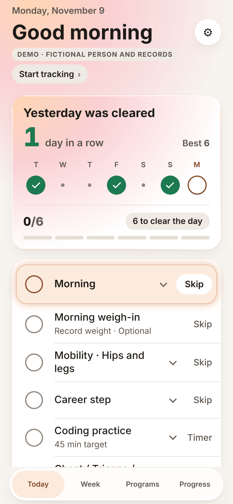
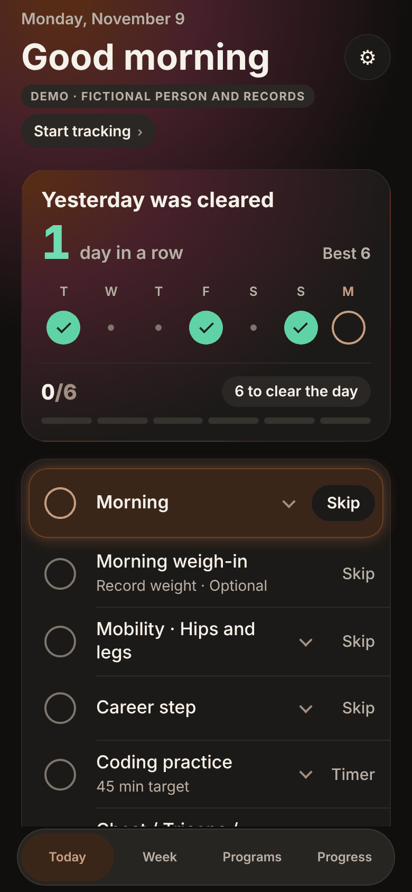
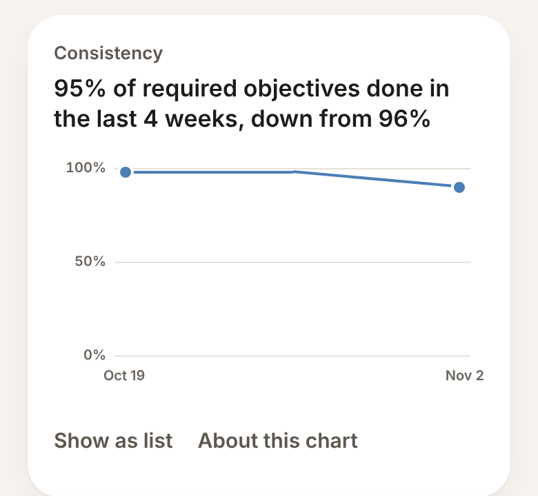

# Design system

One visual system: warm paper in light and warm charcoal in dark, following the phone's appearance, with cards that have soft depth, one warm accent for what is happening now and one green for done. Type is the system's own. Tokens live in `src/ui/theme.ts`, motion in `src/ui/motion.tsx`, and shared components in `src/ui/components.tsx`, `src/ui/list.tsx` and `src/ui/mission.tsx`.

  
  

## Principles

- **Usability over decoration.** Where the two conflict, the clearer layout wins.
- **One meaning per color.** Ember (`accent`) means now: the next objective, today, the selected tab. Fern (`done`) means done. They never swap. Red marks errors and a broken rule only; a missed day or a skip is never red.
- **Neutral primaries.** The primary button is filled in the text color, so green stays the reward and Ember stays "now".
- **Each figure once**, with its chart beside it.
- **Real targets.** Every control is at least 44 × 44 pt, except the days of the 28-day study and trading calendars: each is 44 pt tall and spans its whole column, which can be narrower than 44 pt (at least 32 pt) on the smallest phones.
- **Motion follows state.** Nothing loops or animates for its own sake, and Reduce Motion shows final states directly.
- **The everyday view stays short.** Useful detail that is not daily is folded one tap away.

## Tokens

Every color token has a light and a dark value (`tokens.light`, `tokens.dark`). Screens never branch on the appearance: `palette` holds one adaptive color per token.

- **iOS:** each color is a `DynamicColorIOS`, which UIKit resolves for the current appearance, including inside shadows and symbol tints.
- **Web:** each color is a CSS variable. `src/app/+html.tsx` writes both appearances into the page head under `prefers-color-scheme`, so the static prerender is the same for everyone and hydration never mismatches.

| Token     | Light     | Dark      | Use                                              |
| --------- | --------- | --------- | ------------------------------------------------ |
| `canvas`  | `#F7F4EF` | `#100F0E` | The page                                         |
| `surface` | `#FFFFFF` | `#1C1A18` | Cards and sheets                                 |
| `fill`    | `#EFEAE3` | `#2A2724` | Control tracks, secondary buttons                |
| `label`   | `#1D1B18` | `#F5F1EB` | Primary text and the primary button              |
| `label2`  | `#5C564F` | `#B8B0A6` | Secondary text                                   |
| `label3`  | `#6B645C` | `#9A9187` | Small labels                                     |
| `accent`  | `#AE4E18` | `#FF9A57` | Ember: the active check, today, the selected tab |
| `done`    | `#1C7A50` | `#5FD3A6` | Fern: done checks, progress fills                |
| `danger`  | `#B3412E` | `#E08A76` | Errors and a broken rule                         |
| `chart`   | `#4A7FB8` | `#6FA6DE` | The series color of Progress charts              |

Each accent also has text, tint and edge steps (`accentText`, `accentTint`, `accentEdge`, and the same for `done`). The trading screens have their own `market` palette (bull, bear, a neutral blue and amber), used nowhere else and never meaning done or now.

**Contrast** follows the WCAG 2.2 formula. `src/ui/__tests__/theme.test.ts` checks every text color at 4.5:1 and every mark at 3:1 on each ground it sits on, in both appearances, and a browser test reads the rendered colors.

## Typography

All type is the system's: SF Pro for text and SF Pro Rounded (`ui-rounded`) for figures, with tabular digits. No font is bundled for text, and Dynamic Type and Bold Text come from the system. Chromium has no rounded face, so the browser preview shows the plain system font for figures.

| Style        | Face and size           | Use                                 |
| ------------ | ----------------------- | ----------------------------------- |
| `title`      | SF Pro Bold 34/41       | Screen titles                       |
| `sheetTitle` | SF Pro Bold 22/28       | Sheet titles                        |
| `heading`    | SF Pro Semibold 17/22   | Card and item headings              |
| `item`       | SF Pro Medium 17/22     | Objective titles                    |
| `body`       | SF Pro Regular 17/23    | Reading text                        |
| `caption`    | SF Pro Regular 14/19    | Status lines ("Done · 8:00 AM")     |
| `tag`        | SF Pro Bold 11/14, caps | Word tags such as DEMO and PRACTICE |
| `hero`       | SF Rounded Heavy 44/50  | "Day cleared"                       |
| `count`      | SF Rounded Heavy 28/32  | The day's count and streak figures  |
| `value`      | SF Rounded Heavy 21/26  | Recorded figures                    |

Source strings stay in sentence case; uppercase is a style, so accessible names and tests read the original words. Under Dynamic Type everything scales and wraps, with caps on a few titles so the layout holds.

## Layout and components

- A 4 pt grid, 20 pt page margins, and content centered at most 720 pt wide.
- Concentric corners: cards 24, panels 20, rows inside a card 18, fields 14. Buttons, chips and the tab bar are capsules.
- Cards have two warm shadows in light, and no shadow but a faint inner edge in dark.
- Every sheet and full-screen view carries its own `SafeAreaProvider`, because a native modal does not inherit the app's.
- The round objective check is a 30 pt circle in a 44 pt target: an outline when open, Ember for the next thing to do, solid Fern when done, dashed when skipped.
- An on/off setting is always a switch row with a caption saying what the current state means, never a button.

## Charts

Charts are drawn with views (`line-chart.tsx`, `bar-chart.tsx`, `habit-bars.tsx`, `chart-scale.ts`), not a chart library.

- A trend is a line, a weekly total a column, and habits a sorted bar list. Never a second y axis, a pie or a donut.
- The y axis is labeled at round values (`niceScale`). Lines are drawn between recorded points only; a gap stays a gap.
- Pressing and dragging snaps a readout to the nearest point, and **Show as list** swaps the plot for rows that VoiceOver reads as sentences.
- With fewer than two points a card shows its headline and one line, never an empty frame.

## Motion

| Token (`motion`)      | Value                     | Used for                                 |
| --------------------- | ------------------------- | ---------------------------------------- |
| `spring`              | damping 18, stiffness 260 | A check filling, a segment, the tab pill |
| `enter`               | 220 ms                    | Sheets, the count roll                   |
| `press`, `pressScale` | 90 ms, 0.97               | Press-in                                 |
| `reveal`              | 520 ms                    | The Day Cleared panel                    |

- Today opens settled: nothing animates on launch or on changing dates.
- A check draws its tick only after its save succeeds, so unsaved work never shows as done.
- The one celebration plays when a save on Today clears the day: the seal closes, the streak rolls up, today's progress moments are listed and about 30 pieces of confetti fall once.
- A light haptic confirms a saved Done, and the success pattern marks Day Cleared. Haptics stay under Reduce Motion.

## Accessibility

- Labels say what changes: "Mark Morning done", "Skip …", "Undo …".
- React Native Web ignores `accessibilityState`, so switches, chips, segments and calendar days also expose `aria-checked` or `aria-selected`, and charts `aria-valuetext`.
- Grouped content reads as one: the hero card reads its headline, streak and best as one heading.
- Announcements follow saves: Day cleared, or a save or load failure, is spoken only after the save settles.
- Decoration (confetti, the celebration's symbols) is hidden from VoiceOver.

## Widgets

The widgets use the same tokens, SF Pro for words and SF Pro Rounded for times, with a card that settles from `surface` into `canvas`. Every word meets 4.5:1 and every colored symbol 3:1 on its ground, and the widget tests compute this for every state. On tinted and clear Home Screens, in StandBy and on the Lock Screen the system recolors widgets, so they set no color there and let text and symbols carry the meaning. What each widget may show is in [DATA_PRIVACY.md](DATA_PRIVACY.md#home-screen-widgets).

## Copy

- Plain, short, sentence-case words that say what a control does or what happened.
- Facts without blame: a missed day is a faint dot, and a celebration never mentions a day not cleared.
- Counts are pluralized ("1 habit due", "2 habits due").
- No XP, levels, badges, points, leaderboards or motivational feeds.
